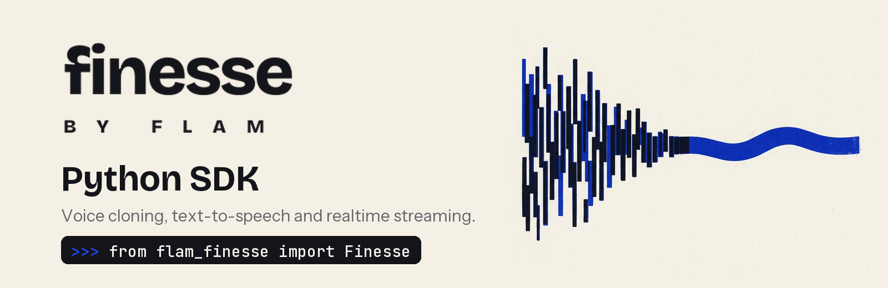
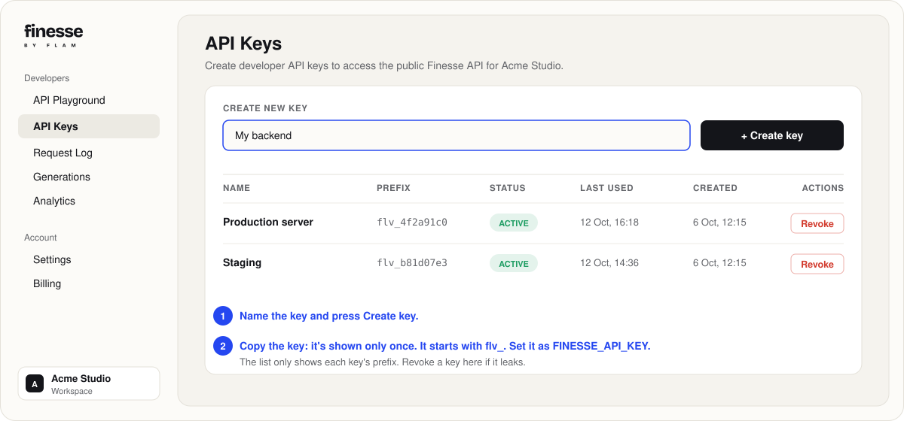
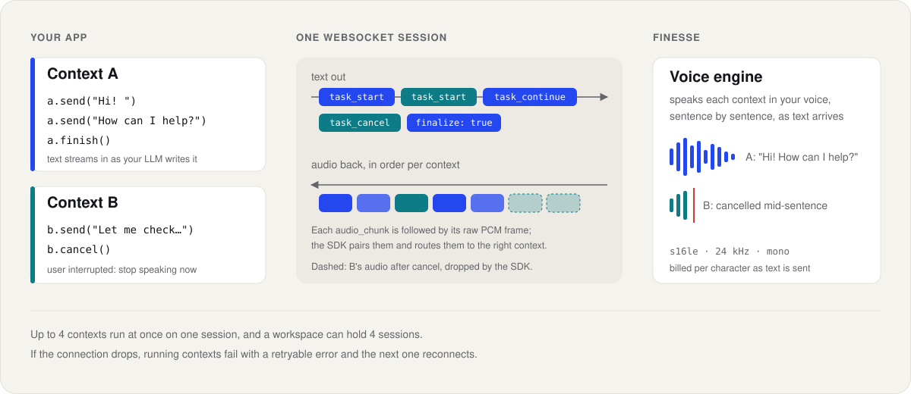

<picture>
  <source media="(prefers-color-scheme: dark)" srcset="./.github/assets/banner-python-dark.png">
  <source media="(prefers-color-scheme: light)" srcset="./.github/assets/banner-python-light.png">
  
</picture>

<p>
  
  
  
</p>

# Finesse Python SDK

The official Python library for [Finesse](https://finesse.flamapp.ai), Flam's voice platform.
Clone a voice from a few seconds of audio, turn text into speech in that voice, and stream it in
realtime to voice agents, with a few lines of code.

- **Typed** sync and async clients, built on `httpx` and Pydantic.
- **Realtime** over one WebSocket: stream text in as your LLM writes it, get audio back, cancel
  on barge-in.
- **Safe by default**: retries that never double-bill, typed errors, timeouts.

**[Documentation](https://finesse.flamapp.ai/guides/overview)** ·
**[API reference](https://finesse.flamapp.ai/voice-api/list-voices)** ·
**[Dashboard](https://finesse.flamapp.ai/dashboard)** ·
**[Changelog](./CHANGELOG.md)**

## Contents

- [Installation](#installation)
- [Get an API key](#get-an-api-key)
- [Quickstart](#quickstart)
- [Voices](#voices)
- [Clone a voice](#clone-a-voice)
- [Text to speech](#text-to-speech)
- [Streaming speech](#streaming-speech)
- [Realtime](#realtime)
- [Async usage](#async-usage)
- [Which method should I use?](#which-method-should-i-use)
- [Audio formats](#audio-formats)
- [Handling errors](#handling-errors)
- [Retries](#retries)
- [Timeouts](#timeouts)
- [Per-request options](#per-request-options)
- [Request IDs](#request-ids)
- [Advanced](#advanced)
- [Requirements](#requirements)

## Installation

The SDK is in private preview, so install it from GitHub (you need access to the repository):

```sh
pip install "git+ssh://git@github.com/homingos/finesse-python.git"
# or
uv add "git+ssh://git@github.com/homingos/finesse-python.git"
```

Once it is published this becomes `pip install flam-finesse`. The import name is `flam_finesse`.

## Get an API key

1. Sign in to the [Finesse dashboard](https://finesse.flamapp.ai/dashboard).
2. Open **Settings → API keys** and create a key. Copy it right away: it is shown only once,
   and it starts with `flv_`.
3. Put it in your environment, where the SDK finds it:

```sh
export FINESSE_API_KEY="flv_..."
```

Keep the key on your server. Anyone who has it can spend your workspace's credits.

<p align="center">
  
</p>

## Quickstart

```python
from flam_finesse import Finesse

client = Finesse()  # reads FINESSE_API_KEY

# Pick any voice you can use: your own, or one from the public catalog.
voice = next(v for v in client.voices.list() if v.is_ready)

audio = client.speech.create(voice_id=voice.id, text="Hello from Finesse!")
audio.save("hello.wav")
```

`hello.wav` is a 24 kHz WAV file. That's it.

## Voices

`voices.list()` returns your voices first (newest first), then the public platform voices.
Iterating it walks every page for you.

```python
for voice in client.voices.list():
    print(voice.id, voice.name, voice.status, voice.language, voice.labels)

voice = client.voices.get("665f1a2b3c4d5e6f7a8b9c0d")

client.voices.update(voice.id, name="Narrator (UK)", labels={"accent": "british"})
client.voices.delete(voice.id)
```

Just the first page, with its totals:

```python
page = client.voices.list(page_size=20)
print(page.total, page.has_more, [v.name for v in page.voices])
```

A voice can speak once `voice.status == "ready"` (`voice.is_ready`). Its `alias` (for example
`narrator`) also works as the `voice` on the
[OpenAI-compatible endpoint](https://finesse.flamapp.ai/voice-api/openai-compatible).

## Clone a voice

Upload a clean reference clip (a few seconds to a minute of one speaker, at most 20 MiB) and wait
for the voice to be ready:

```python
voice = client.voices.clone_and_wait(
    name="Ana",
    file="reference.wav",  # a path, bytes, a binary file, or (filename, bytes, type)
    language="en",
    labels={"gender": "female", "accent": "british"},
    ref_text="What the speaker says in the clip, if you have it.",
    on_update=lambda job: print("clone job:", job.status),
)

client.speech.create(voice_id=voice.id, text="This is my cloned voice.").save("ana.wav")
```

`clone_and_wait` creates the voice, uploads the clip, and polls the clone job until it finishes.
The first clone after the cloner has been idle can take a couple of minutes. To start the clone
now and wait later:

```python
clone = client.voices.clone(name="Ana", file="reference.wav")
print(clone.voice.status, clone.job_id)  # "processing", "6660aa00..."
voice = client.voices.wait_until_ready(clone, timeout=300)
```

Cloning raises `CloneFailedError` if the job fails and `CloneTimeoutError` if it doesn't finish in
time. To add a clip to a voice you already created, use `client.voices.enroll(voice_id, file=...)`.

## Text to speech

`speech.create` returns the whole clip in one response (up to 10,000 characters of text):

```python
audio = client.speech.create(
    voice_id=voice.id,
    text="The quick brown fox jumps over the lazy dog.",
    language="en",  # optional; defaults to the voice's language
    output_format="wav",  # default; or raw PCM: "s16le", "s24le", "s32le", "f32le", "f64le"
    num_step=32,  # optional; fewer steps is faster, more is higher quality
)

audio.data  # bytes
audio.content_type  # "audio/wav"
audio.sample_rate  # 24000
audio.generation_id  # id of this clip in your generation history
audio.audio_url  # stored copy of the clip, when storage is enabled
audio.save("fox.wav")
```

Identical requests are served from a cache at no charge. Speech is billed per character of
`text`.

## Streaming speech

`speech.stream` sends audio as it is generated, so playback can start before the whole clip is
ready. Chunks are raw PCM (`s16le`, 24 kHz, mono, unless you set `output_format`).

```python
with client.speech.stream(voice_id=voice.id, text="Hello, streamed.") as stream:
    for chunk in stream:
        speaker.write(chunk.pcm)  # e.g. a sounddevice or pyaudio output stream

print(stream.done.audio_duration_s, stream.done.generation_id)
```

Or collect everything: `pcm = client.speech.stream(voice_id=voice.id, text="...").read_all()`.

Errors before the stream starts raise the usual errors (for example `PaymentRequiredError`).
A failure after it starts raises `StreamError`.

## Realtime

Realtime is for voice agents and anything conversational. One session is one WebSocket. You
send text as it is produced and get audio back as fast as the engine makes it. Each turn of
speech runs in a **context**, and a session can run several contexts at once.

<p align="center">
  
</p>

Realtime uses the async client:

```python
import asyncio
from flam_finesse import AsyncFinesse, AudioEvent


async def main() -> None:
    client = AsyncFinesse()
    async with client.realtime.connect() as rt:
        async for event in rt.say(voice_id=VOICE_ID, text="Hi! How can I help you today?"):
            if isinstance(event, AudioEvent):
                speaker.write(event.pcm)  # s16le, 24 kHz, mono


asyncio.run(main())
```

### Stream text from an LLM

Send text a token or a sentence at a time, then `finish()` the turn:

```python
ctx = rt.context(voice_id=VOICE_ID)


async def speak() -> None:
    async for pcm in ctx.audio():
        speaker.write(pcm)


player = asyncio.create_task(speak())
async for token in llm.stream(prompt):
    await ctx.send(token)
await ctx.finish()
await player
```

### Interruptions (barge-in)

When the user starts talking, cancel the turn. Audio still on its way for that context is
dropped, and iterating the context ends with a `TaskCancelled` event.

```python
await ctx.cancel()
```

### Events

Iterating a context yields, in order:

| Event | When |
|---|---|
| `TaskStarted` | The turn began. Has the `sample_rate` and `audio_format` of its audio. |
| `AudioEvent` | A chunk of audio: `pcm`, `sentence_index`, `chunk_index`. |
| `SentenceDone` | A sentence finished: `text`, `audio_duration_s`. |
| `TaskDone` | The turn finished (last event): `total_audio_duration_s`. |
| `TaskCancelled` | The turn was cancelled (last event). |

A turn that fails raises `RealtimeError` (for example `code == "voice_not_found"`).

### Limits and reconnects

- A session runs up to 4 contexts at once, and a workspace can hold 4 sessions. A fifth session
  raises `RateLimitError` with `code == "too_many_sessions"`, so reuse a session.
- If the connection drops, running contexts raise `RealtimeError`. Check `error.retryable`. The
  next context reconnects automatically (turn this off with `connect(auto_reconnect=False)`).
- Running out of credits ends the session with `RealtimeError(code="insufficient_credits")`.
- Text is billed per character as it is sent. A session reserves credits in blocks of up to
  1,000 characters and returns what it doesn't use when it ends.

## Async usage

`AsyncFinesse` has the same methods as `Finesse`, with `await`:

```python
import asyncio
from flam_finesse import AsyncFinesse


async def main() -> None:
    async with AsyncFinesse() as client:
        async for voice in client.voices.list():
            print(voice.name)
        audio = await client.speech.create(voice_id=VOICE_ID, text="Hello!")
        async with client.speech.stream(voice_id=VOICE_ID, text="Streamed.") as stream:
            async for chunk in stream:
                ...


asyncio.run(main())
```

## Which method should I use?

| You want to... | Use | Why |
|---|---|---|
| Make an audio file, or speak a fixed piece of text | `speech.create` | Simplest. One request, one clip, cached. |
| Start playback fast for a known piece of text | `speech.stream` | Audio starts before the clip is finished. |
| Build a voice agent, or speak text as an LLM writes it | `realtime` | Text in, audio out, many turns on one connection, cancel on barge-in. |

## Audio formats

| `output_format` | What you get | Default for |
|---|---|---|
| `wav` | WAV file | `speech.create` |
| `s16le` | Raw PCM, 16-bit signed little-endian | `speech.stream`, realtime |
| `s24le`, `s32le` | Raw PCM, 24- or 32-bit signed | |
| `f32le`, `f64le` | Raw PCM, 32- or 64-bit float | |
| `opus` | Opus | realtime only |

All audio is mono. The engine's native rate is 24 kHz. You can ask for a higher `sample_rate`,
but lower ones still come back at 24 kHz, so always read the actual rate from
`audio.sample_rate`, `stream.sample_rate` or `TaskStarted.sample_rate`.

## Handling errors

Every error derives from `flam_finesse.FinesseError`. HTTP errors carry `status_code`,
`message`, a machine-readable `code` when the API sends one, and `billing_remaining`.

```python
import flam_finesse as ff

try:
    client.speech.create(voice_id=voice.id, text="Hello!")
except ff.PaymentRequiredError as e:
    print("Out of credits:", e.code, e.billing_remaining)
except ff.RateLimitError:
    print("Slow down and retry.")
except ff.APIStatusError as e:
    print(e.status_code, e.message)
except ff.APIConnectionError:
    print("Could not reach Finesse.")
```

| Error | Status | When |
|---|---|---|
| `BadRequestError` | 400 | Invalid input, text over 10,000 characters, voice not enrolled |
| `AuthenticationError` | 401 | Missing, unknown or revoked API key |
| `PaymentRequiredError` | 402 | `insufficient_credits` or `quota_exhausted` |
| `PermissionDeniedError` | 403 | `feature_disabled`, or `plan_limit_reached` (see `.feature`) |
| `NotFoundError` | 404 | No such voice or job, or not visible to your workspace |
| `RateLimitError` | 429 | Rate limited, or too many realtime sessions |
| `InternalServerError` | 5xx | A server or engine error |
| `APIConnectionError` | | No response; `APITimeoutError` when it timed out |
| `StreamError` | | A speech stream failed after it started |
| `RealtimeError` | | A realtime context or session failed |
| `CloneFailedError`, `CloneTimeoutError` | | Waiting for a clone |

## Retries

Failed requests are retried twice with exponential backoff, honouring `Retry-After`: connection
errors, timeouts, 408, 429 and 5xx.

Calls that create something or cost credits (`speech.create`, `voices.create`, `voices.clone`,
`voices.enroll`) send an `Idempotency-Key`, the same one on every retry, so the service runs
them at most once. A retry of a clone that already succeeded gets the first result back, and a
retried synthesis is served from the cache at no charge. If the first attempt is still running,
the SDK waits for it (up to the request timeout) without using up a retry. To choose the key
yourself, pass it in `extra_headers={"Idempotency-Key": "..."}`.

`speech.stream` has no key, so it is only retried when the server certainly did no work: the
connection never opened, 429, 502 or 503.

```python
client = Finesse(max_retries=5)  # every request
client.speech.create(voice_id=voice.id, text="Hello!", max_retries=0)  # one request
```

## Timeouts

Requests time out after 120 seconds (10 seconds to connect). Synthesis on a cold engine can take
a while to start, so keep this generous. For streams the timeout is the longest wait between
chunks, not the whole stream.

```python
import httpx

client = Finesse(timeout=60.0)  # seconds
client = Finesse(timeout=httpx.Timeout(60.0, connect=5.0))  # finer control
client.voices.get(voice.id, timeout=10.0)  # one request
```

A timeout raises `APITimeoutError`.

## Per-request options

Every request method accepts `timeout`, `max_retries` and `extra_headers` for that call only:

```python
client.speech.create(
    voice_id=voice.id,
    text="Hello!",
    timeout=30.0,
    max_retries=0,
    extra_headers={"X-Request-Id": "abc-123"},
)
```

On `jobs.wait`, `voices.wait_until_ready` and `voices.clone_and_wait`, `timeout` means the
overall time to wait for the clone.

## Request IDs

Every response has an `X-Request-Id`. Errors carry it as `error.request_id`; quote it when you
contact support.

```python
try:
    client.voices.get("665f1a2b3c4d5e6f7a8b9c0d")
except ff.NotFoundError as e:
    print(e.request_id)  # "req_3f9c..."
```

## Advanced

### Raw responses

`client.with_raw_response` has the same methods and returns the HTTP response with the result:

```python
raw = client.with_raw_response.speech.create(voice_id=voice.id, text="Hello!")
print(raw.status_code, raw.request_id, raw.headers["X-Sample-Rate"])
audio = raw.parse()  # what speech.create returns
```

### Logging

Set `FINESSE_LOG=debug` to log every request (method, URL, status, timing, request id), or
`FINESSE_LOG=info` to log only retries. The SDK logs to the standard `logging` module under the
`flam_finesse` logger, so you can also configure it yourself. It never logs your API key,
request bodies or audio.

### Copying a client with other defaults

`with_options` returns a copy that shares the connection pool:

```python
quick = client.with_options(timeout=10.0, max_retries=0)
quick.voices.list()
```

### Environments

The client talks to production by default. Point it elsewhere with `base_url` or
`FINESSE_BASE_URL`:

```python
client = Finesse(base_url="https://finesse.example.test")
```

### Configuration

| Argument | Environment variable | Default |
|---|---|---|
| `api_key` | `FINESSE_API_KEY` | required |
| `base_url` | `FINESSE_BASE_URL` | `https://fi.production.flamapis.com` |
| `timeout` | | 120 s (10 s to connect) |
| `max_retries` | | 2 |
| `default_headers` | | none |
| `http_client` | | a new `httpx.Client` / `httpx.AsyncClient` |

### Custom HTTP client

Pass your own `httpx` client for proxies, custom transports or connection limits. The SDK does
not close a client you pass in.

```python
import httpx

client = Finesse(http_client=httpx.Client(proxy="http://proxy.internal:8080"))
```

### Closing the client

The client holds a connection pool. Close it when you are done, or use it as a context manager:

```python
with Finesse() as client:
    ...
```

### Attribution

Requests identify the SDK with an `X-Finesse-Client` header. If you build an integration on top
of the SDK, name it so it shows up in your usage analytics:

```python
client = Finesse(default_headers={"X-Finesse-Client": "my-app/1.0.0"})
```

## Examples

Runnable scripts are in [`examples/`](./examples): [`speak.py`](./examples/speak.py),
[`clone.py`](./examples/clone.py) and [`realtime.py`](./examples/realtime.py).

## Requirements

Python 3.10 or newer. Dependencies: `httpx`, `pydantic` (v2) and `websockets` (14 or newer).

## Versioning

The SDK follows [semantic versioning](https://semver.org). Before 1.0, minor versions may
include breaking changes; they are listed in the [changelog](./CHANGELOG.md).

```python
import flam_finesse

print(flam_finesse.__version__)
```

## Contributing

```sh
uv sync
uv run pytest                     # unit tests, no network
uv run ruff check . && uv run ruff format --check . && uv run mypy src/flam_finesse
```

Contract tests run against a real API (they synthesize a few short sentences, which is billed)
and refuse to run against production:

```sh
FINESSE_LIVE=1 FINESSE_API_KEY=flv_... \
FINESSE_BASE_URL=https://finesse.example.test uv run pytest tests/live -v
```
